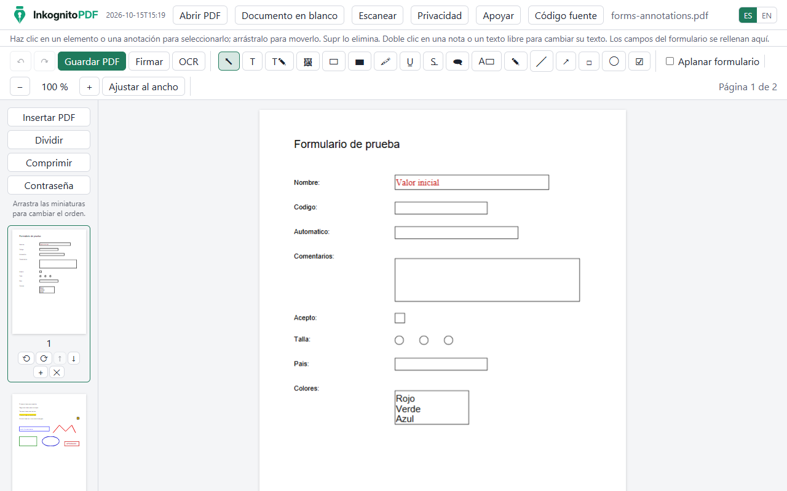
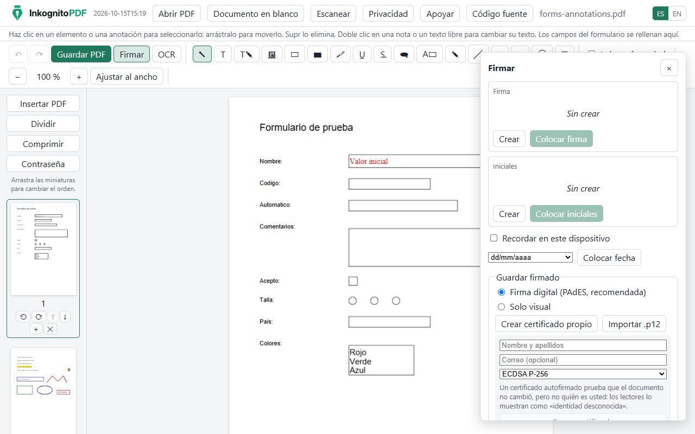
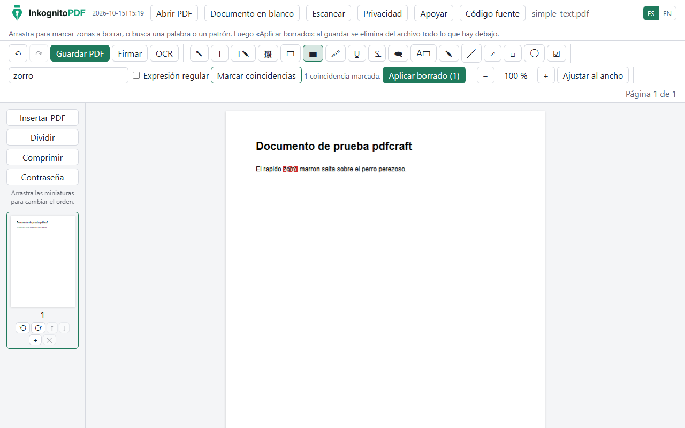
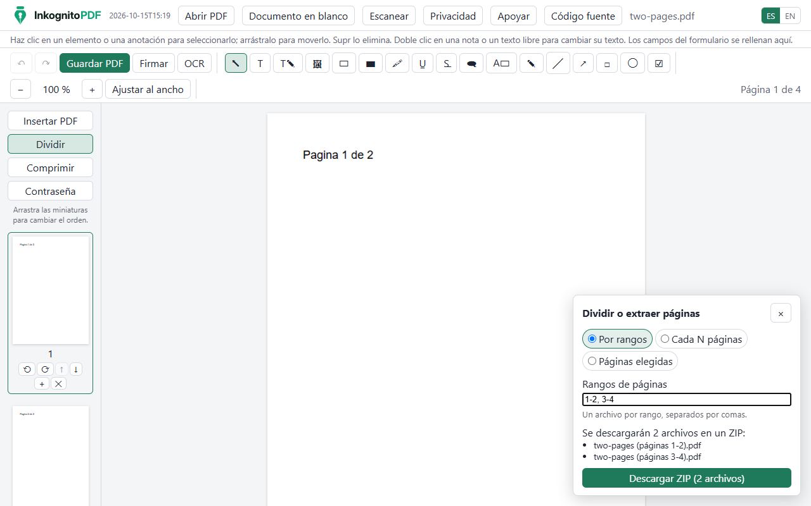
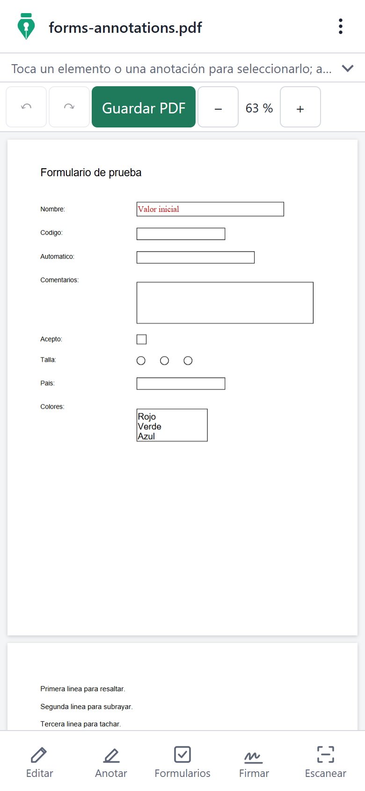
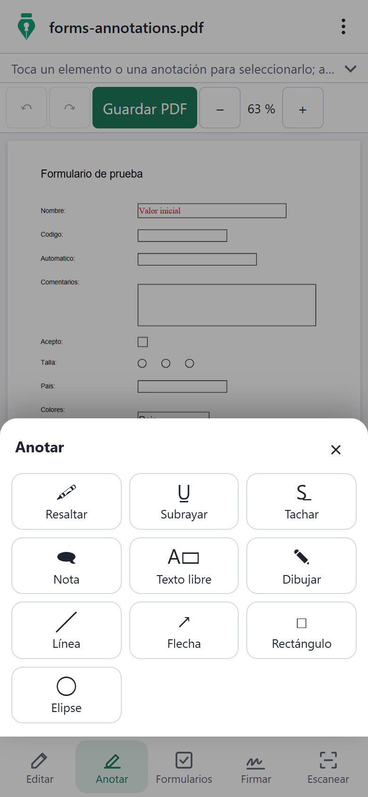
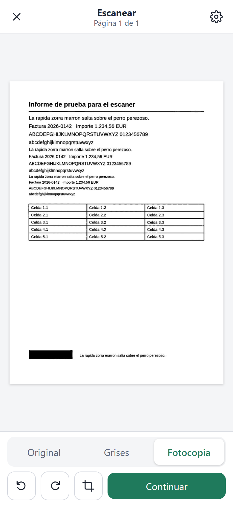

<p align="center">
  <picture>
    <source media="(prefers-color-scheme: dark)" srcset="public/brand/logo-dark.svg" />
    
  </picture>
</p>

<p align="center">
  <a href="README.md">English</a> · <b>Español</b>
</p>

<p align="center">
  <b>Edita, escanea y firma PDFs sin que salgan de tu dispositivo.</b><br />
  Un editor de PDF y escáner de documentos gratis y privado que funciona entero en tu navegador.
</p>

<p align="center">
  <a href="https://inkognitopdf.web.app/app/"><b>Abrir la app →</b></a>
  ·
  <a href="https://inkognitopdf.web.app/">Sitio web</a>
  ·
  <a href="LICENSE">Apache-2.0</a>
</p>



## Compromiso de privacidad

- **Tus archivos nunca salen de tu dispositivo.** Abrir, editar, reconocer texto, firmar, borrar, unir, comprimir, cifrar y guardar ocurre en el navegador. No hay ningún servidor que reciba documentos, firmas ni certificados.
- **Funciona sin conexión.** Es una PWA que se puede instalar; los modelos de OCR y las fuentes se guardan la primera vez que se usan.
- **Sin cuentas ni anuncios.**
- **La medición de uso es opcional.** Solo si el visitante la acepta se envían conteos anónimos de uso (Google Analytics a través de Firebase), y nunca incluyen nombres de archivo, texto ni contenido: la lista cerrada de eventos está en [`src/analytics/events.ts`](src/analytics/events.ts). Sin aceptarla, la app no hace ninguna petición a Google.

## Funciones

|                            |                                                                                                                                                                                                                             |
| -------------------------- | --------------------------------------------------------------------------------------------------------------------------------------------------------------------------------------------------------------------------- |
| **Editar texto**           | Cambia el texto que ya está en el PDF conservando su fuente, tamaño, color y grosor. Añade texto, imágenes y blanqueos.                                                                                                     |
| **Anotar**                 | Resaltado, subrayado, tachado, notas, texto libre, dibujo, líneas, flechas, rectángulos y elipses, guardados como anotaciones estándar.                                                                                     |
| **Formularios**            | Rellena campos AcroForm, crea campos nuevos de seis tipos y aplana el formulario.                                                                                                                                           |
| **Firmar**                 | Firma dibujada, escrita o desde una foto; firma digital **PAdES** con un certificado creado en el dispositivo o importado de un `.p12`; varios firmantes en orden, con página de registro opcional; verificación de firmas. |
| **Escanear**               | Fotografía papeles con el móvil: detección de la página, corrección de perspectiva y un filtro limpio de fotocopia en blanco y negro.                                                                                       |
| **OCR**                    | Reconoce el texto de los escaneos en español e inglés (Tesseract.js) para buscarlo, seleccionarlo y copiarlo.                                                                                                               |
| **Editar texto escaneado** | Reemplaza una línea reconocida dentro de la imagen escaneada, igualando el papel y la tinta.                                                                                                                                |
| **Borrado seguro**         | Marca zonas o busca palabras o patrones y elimina de verdad el texto, las imágenes, las anotaciones y los metadatos que hay debajo.                                                                                         |
| **Unir y dividir**         | Abre varios PDFs como uno, inserta PDFs, ordena las páginas arrastrándolas, divide por rangos o cada N páginas o extrae páginas (ZIP si salen varios archivos).                                                             |
| **Comprimir**              | Reduce el tamaño: las imágenes se ajustan a lo que su página necesita y se codifican de nuevo, con tres niveles y el tamaño antes y después.                                                                                |
| **Contraseñas**            | Abre PDFs protegidos (RC4 y AES, hasta AES-256) y guarda con contraseña AES-256; restricciones opcionales de imprimir y copiar, que la app explica que son solo orientativas.                                               |
| **Páginas**                | Gira, elimina, inserta páginas en blanco y empieza desde un documento en blanco.                                                                                                                                            |
| **Idiomas**                | Español e inglés, en el ordenador y en el teléfono.                                                                                                                                                                         |

## Capturas

| Firmar                                     | Borrado seguro                                           | Dividir                                         |
| ------------------------------------------ | -------------------------------------------------------- | ----------------------------------------------- |
|  |  |  |

| Teléfono                                            | Anotar en el teléfono                                                          | Escáner                                                   |
| --------------------------------------------------- | ------------------------------------------------------------------------------ | --------------------------------------------------------- |
|  |  |  |

Todas las imágenes usan documentos de muestra sintéticos. Se regeneran con `npm run build` y `node scripts/readme-images.mjs`.

## Primeros pasos

Requisito: **Node.js 24** o superior.

```bash
npm install          # dependencias, instaladas en el proyecto
npm run dev          # servidor de desarrollo
npm test             # pruebas unitarias (Vitest)
npm run test:e2e     # pruebas de extremo a extremo (Playwright; antes compila)
npm run build        # compilación de producción con service worker sin conexión, en dist/
```

Otros scripts: `npm run lint`, `npm run typecheck`, `npm run format:check` y `npm run fixtures`, que regenera los PDFs de prueba sintéticos.

Las pruebas de extremo a extremo usan el Chrome instalado en el equipo. Si están `openssl` y `qpdf`, las pruebas también comprueban con ellos las firmas y los archivos.

### Publicar

La compilación en `dist/` es un sitio estático: la landing en `/` y la app en `/app/`. [`firebase.json`](firebase.json) tiene la configuración de Firebase Hosting (reescrituras y cabeceras de caché). Para publicar tu propia copia, crea un proyecto de Firebase, pon su id en `.firebaserc` y ejecuta `npx firebase-tools deploy --only hosting`. No hace falta ningún secreto para compilar ni para publicar. La configuración web de `src/analytics/firebase.ts` identifica la app web pública y no es un secreto.

## Estructura del proyecto

```
index.html        landing (textos de src/i18n, escritos por la compilación)
app/index.html    la app
src/
  landing/        script y estilos de la landing
  editor/         interfaz del editor: herramientas, paneles, guardar, dividir
  engine/         escritura de PDFs con pdf-lib: texto, fuentes, formularios, borrado, unir y dividir
  model/          estado del documento, operaciones e historial para deshacer
  viewer/         render con pdf.js: páginas, capa de texto, miniaturas, zoom
  scan/           escáner: detección de la página, perspectiva, filtro B/N (Web Worker)
  ocr/            OCR con Tesseract.js y capa de texto seleccionable
  sign/           firmas: dibujo, PAdES, verificación, varios firmantes
  storage/        abrir archivos (el original nunca se modifica), ZIP
  analytics/      consentimiento y lista cerrada de eventos de uso
  support/        enlaces de donación
  i18n/           textos en español (referencia) e inglés
tests/            pruebas unitarias y fixtures sintéticos
e2e/              pruebas de extremo a extremo (Playwright)
scripts/          copia de recursos, fixtures, iconos, capturas
public/brand/     logo e iconos
```

## Tecnologías

| Componente                                                                             | Licencia         | Uso                                  |
| -------------------------------------------------------------------------------------- | ---------------- | ------------------------------------ |
| [React](https://react.dev)                                                             | MIT              | Interfaz                             |
| [pdf.js](https://github.com/mozilla/pdf.js) (`pdfjs-dist`)                             | Apache-2.0       | Render y capa de texto               |
| [pdf-lib](https://github.com/Hopding/pdf-lib) y `@pdf-lib/fontkit`                     | MIT              | Escritura de PDFs                    |
| [Tesseract.js](https://github.com/naptha/tesseract.js) y sus datos de español e inglés | Apache-2.0       | OCR en el navegador                  |
| [PKI.js](https://github.com/PeculiarVentures/PKI.js), asn1js                           | BSD-3-Clause     | CMS, X.509 y PKCS#12 para las firmas |
| Arimo, Tinos, Cousine, Carlito, Caladea, Dancing Script, Great Vibes, Caveat           | OFL-1.1          | Fuentes de sustitución y manuscritas |
| Firebase Analytics (opcional, con consentimiento)                                      | Apache-2.0       | Conteos anónimos de uso              |
| Vite, Vitest, Playwright, TypeScript, ESLint, Prettier                                 | MIT / Apache-2.0 | Compilación y pruebas                |

Lista completa y notas: [`THIRD_PARTY_NOTICES.md`](THIRD_PARTY_NOTICES.md).

## Cómo contribuir

Los issues y los pull requests son bienvenidos. Unas pocas reglas mantienen el proyecto como es:

- **Todo se queda en el dispositivo.** Ninguna función puede enviar documentos ni su contenido a un servidor.
- **Código en sala limpia.** Escribe tu propio código; no copies código, recursos ni textos de productos de PDF propietarios.
- **Solo licencias abiertas.** Las dependencias nuevas deben ser compatibles con Apache-2.0 (nada de GPL ni AGPL).
- **Los dos idiomas.** Todo texto visible va en `src/i18n/es` y `src/i18n/en`.
- **También en el teléfono.** Los controles funcionan con el dedo y miden al menos 44 px de alto.
- **Las pruebas en verde.** Ejecuta `npm test`, `npm run test:e2e`, `npm run lint` y `npm run format:check` antes de abrir un pull request. Los documentos de prueba deben ser sintéticos, nunca archivos personales reales.

## Licencia

Copyright 2026 David Mogollon. Publicado bajo la [Apache License 2.0](LICENSE). Ver también [`NOTICE`](NOTICE).

## Apoya el proyecto

InkognitoPDF es gratis. Si te resulta útil, puedes apoyar su desarrollo:

- **Desde Colombia, con Mercado Pago** (pesos colombianos): [$10.000](https://mpago.li/1Kyib9Q) · [$20.000](https://mpago.li/1sVMAt1) · [$50.000](https://mpago.li/2s9ot7Z) · [otro monto](https://link.mercadopago.com.co/damofer)
- **Fuera de Colombia, con [Ko-fi](https://ko-fi.com/damofer)** (dólares estadounidenses)

¡Gracias!
