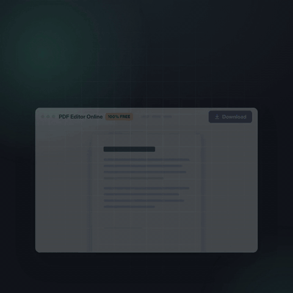
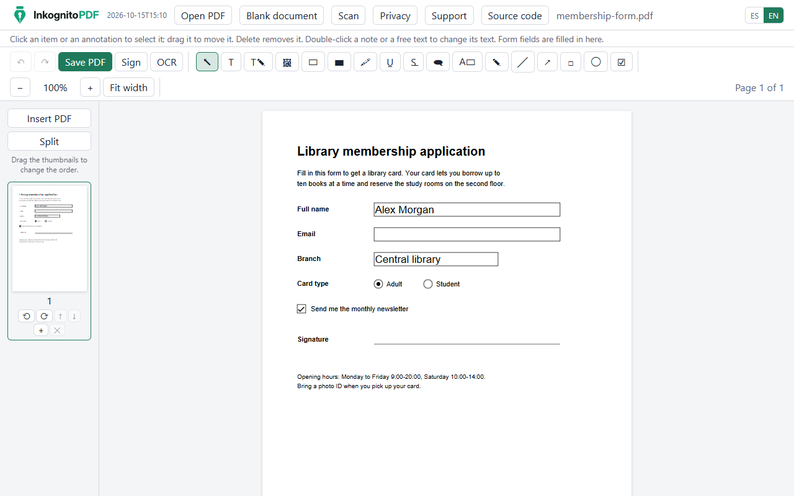
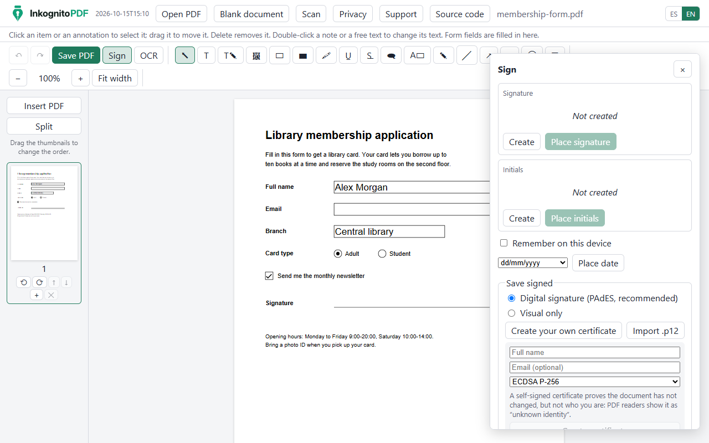
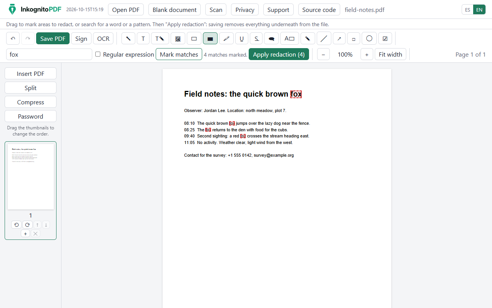
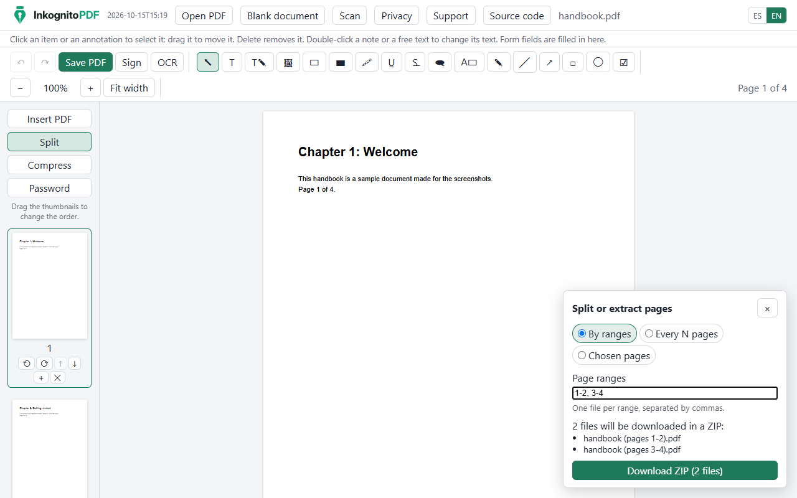
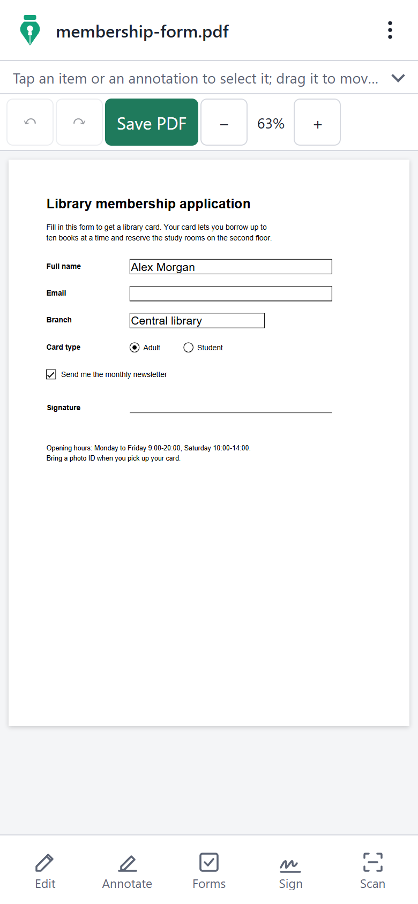
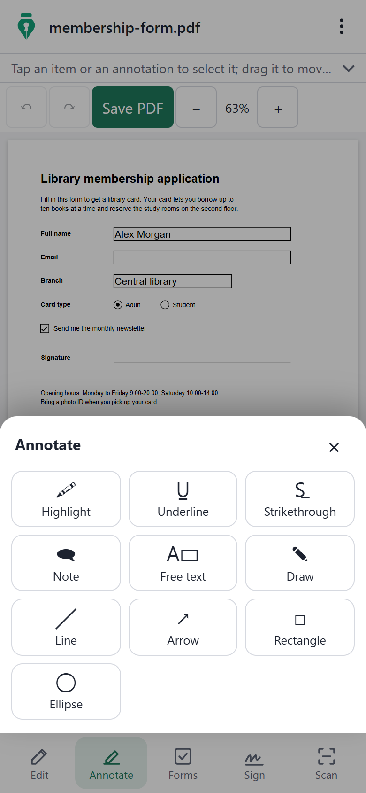
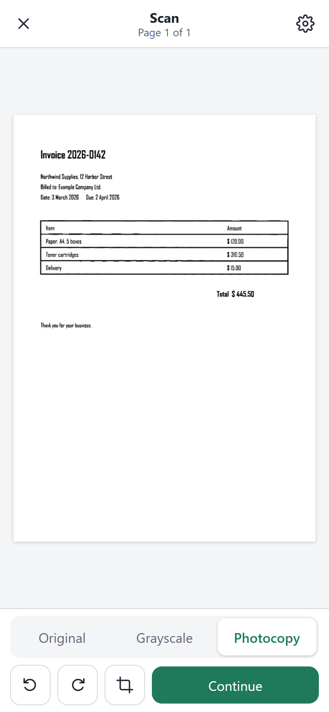

<p align="center">
  <picture>
    <source media="(prefers-color-scheme: dark)" srcset="public/brand/logo-dark.svg" />
    
  </picture>
</p>

<p align="center">
  <a href="https://inkognitopdf.com">
    
  </a>
</p>

<p align="center">
  <b>English</b> · <a href="README.es.md">Español</a>
</p>

<p align="center">
  <b>Edit, scan and sign PDFs without them ever leaving your device.</b><br />
  A free, private PDF editor and document scanner that runs entirely in your browser.
</p>

<p align="center">
  <a href="https://inkognitopdf.com/app/"></a>
  <a href="https://github.com/damofer/inkognitopdf"></a>
</p>

<h2 align="center">❤️ Support development</h2>

<p align="center">
  InkognitoPDF is free, with no ads and no accounts. If it is useful to you, your support helps me keep it that way and keep adding features.
</p>

<p align="center">
  Support is completely optional: using the app, sharing it and reporting issues already helps the project a lot.
</p>

<p align="center">
  <a href="https://ko-fi.com/damofer"></a>
  <a href="https://link.mercadopago.com.co/damofer"></a>
</p>

<p align="center">
  From Colombia, in pesos: <a href="https://mpago.li/1Kyib9Q">$10.000</a> · <a href="https://mpago.li/1sVMAt1">$20.000</a> · <a href="https://mpago.li/2s9ot7Z">$50.000</a> · <a href="https://link.mercadopago.com.co/damofer">other amount</a>
</p>

<p align="center">Thank you for supporting the project. ❤️</p>

<p align="center">
  
  
  
  <a href="LICENSE"></a>
</p>

---



## Privacy promise

- **Your files never leave your device.** Opening, editing, OCR, signing, redacting, merging, compressing, encrypting and saving all happen in the browser. There is no server that receives documents, signatures or certificates.
- **Works offline.** It is an installable PWA; the OCR models and fonts are cached the first time they are used.
- **No accounts and no ads.**
- **Usage measurement is optional.** Anonymous usage counts (Google Analytics through Firebase) are sent only if the visitor accepts them, and they never include file names, text or any content: see the closed list of events in [`src/analytics/events.ts`](src/analytics/events.ts). Without consent, the app makes no request to Google.
- **The timestamp is optional.** If you tick “Add a timestamp” when signing, the app sends a SHA-256 hash of the signature to `/tsa` on the site itself, which forwards it to DigiCert to certify the time. It carries neither the document nor anything about you ([`functions/relay.js`](functions/relay.js)).

### Check it yourself

You don't have to take our word for it.

1. **Read the header.** Every page is served with a `Content-Security-Policy` whose `connect-src` only allows the site itself and the Google Analytics addresses (contacted only after you accept the usage measurement). The browser refuses any other connection, whatever the code tries. Run `curl -sI https://inkognitopdf.com/app/` or look at the response headers of `/app/` in DevTools. The policy is defined in [`src/csp.ts`](src/csp.ts).
2. **Watch the Network tab.** Open [the app](https://inkognitopdf.com/app/), open DevTools on the Network tab and clear it. Then open a PDF, edit it, sign it and save it. Every request goes to `inkognitopdf.com` (fonts, the OCR engine and other app files), and none carries your document. With Google Analytics accepted you will also see requests to Google with the event names, never file names or content. Signing with a timestamp adds one request to `/tsa` of about 80 bytes: the hash of the signature.
3. **Go offline.** Once the app has loaded, turn on airplane mode: it keeps working, because nothing needs a server. Only the optional timestamp needs a connection.

## Features

|                       |                                                                                                                                                                                                                                                          |
| --------------------- | -------------------------------------------------------------------------------------------------------------------------------------------------------------------------------------------------------------------------------------------------------- |
| **Edit text**         | Change the text already in the PDF, keeping its font, size, color and weight. Add text, images and whiteout.                                                                                                                                             |
| **Annotate**          | Highlight, underline, strike out, notes, free text, drawing, lines, arrows, rectangles and ellipses, saved as standard annotations.                                                                                                                      |
| **Forms**             | Fill in AcroForm fields, create new ones of six types, and flatten the form.                                                                                                                                                                             |
| **Sign**              | Drawn, typed or photographed signatures; digital **PAdES** signatures with a certificate created on the device or imported from a `.p12`; several signers in order, with an optional audit page; optional timestamp (PAdES B-T); signature verification. |
| **Scan**              | Photograph paper with the phone: page detection, perspective correction and a clean black-and-white "photocopy" filter.                                                                                                                                  |
| **OCR**               | Recognize the text of scans in English and Spanish (Tesseract.js) so it can be searched, selected and copied.                                                                                                                                            |
| **Edit scanned text** | Replace a recognized line inside the scanned image, matching the paper and the ink.                                                                                                                                                                      |
| **Secure redaction**  | Mark areas or search for words or patterns, then really remove the text, images, annotations and metadata underneath.                                                                                                                                    |
| **Merge and split**   | Open several PDFs as one, insert PDFs, reorder pages by dragging, split by ranges or every N pages, or extract pages (ZIP for several files).                                                                                                            |
| **Compress**          | Make files smaller: images are scaled down to what their page needs and encoded again, with three levels and the size before and after.                                                                                                                  |
| **Passwords**         | Open protected PDFs (RC4 and AES, up to AES-256) and save with an AES-256 password; optional print and copy restrictions, which the app explains are only advisory.                                                                                      |
| **Pages**             | Rotate, delete and insert blank pages.                                                                                                                                                                                                                   |
| **Templates**         | Resumes, cover letters, invoices, quotes, payment requests, receipts and letters ready to fill in, with a live preview, colors, fonts and paper size; download the PDF or keep editing it in the app.                                                    |
| **Write documents**   | Write from scratch as in Word or Google Docs: headings, lists, bold, colors, highlight, alignment, images and page breaks, with page breaks shown as you type; the result is a PDF with real text, to download, sign or add to the open PDF.             |
| **Languages**         | English and Spanish, on desktop and on phones.                                                                                                                                                                                                           |

## Screenshots

| Sign                                      | Secure redaction                              | Split                                    |
| ----------------------------------------- | --------------------------------------------- | ---------------------------------------- |
|  |  |  |

| Phone                                      | Annotate on a phone                                                | Scanner                                         |
| ------------------------------------------ | ------------------------------------------------------------------ | ----------------------------------------------- |
|  |  |  |

All pictures use synthetic sample documents. They are regenerated with `npm run build` and `node scripts/readme-images.mjs`.

## Quick start

Requirements: **Node.js 24** or newer.

```bash
npm install          # dependencies, installed locally
npm run dev          # development server
npm test             # unit tests (Vitest)
npm run test:e2e     # end-to-end tests (Playwright; builds first)
npm run build        # production build with the offline service worker, in dist/
```

Other scripts: `npm run lint`, `npm run typecheck`, `npm run format:check`, and `npm run fixtures` to regenerate the synthetic test PDFs.

The end-to-end tests use the Chrome installed on the machine. When `openssl` and `qpdf` are available, the tests also check signatures and files with them.

### Deploying

The build in `dist/` is a static site: the landing page at `/` and the app at `/app/`. [`firebase.json`](firebase.json) has the Firebase Hosting configuration (rewrites and cache headers). To deploy your own copy, create a Firebase project, put its id in `.firebaserc` and run `npx firebase-tools deploy --only hosting,functions`. The timestamp relay (`/tsa`) is a Cloud Function in [`functions/`](functions/), which needs Firebase's Blaze plan. No secret is needed to build or deploy. The web configuration in `src/analytics/firebase.ts` identifies the public web app and is not a secret.

### Self-hosting with Docker

The [`Dockerfile`](Dockerfile) builds the site and serves it with nginx, with the same routes and cache headers as `firebase.json` ([`docker/nginx.conf`](docker/nginx.conf)):

```bash
docker build -t inkognitopdf .
docker run -d -p 8080:80 inkognitopdf
```

The container only serves files and forwards timestamp requests to DigiCert, which carry a hash and never the document: documents are processed in the browser. Serve it over HTTPS (for example behind your reverse proxy), since browsers only allow the camera and the offline service worker in a secure context. Copies on another domain never measure usage.

## Project structure

```
index.html        landing page (texts from src/i18n, written in by the build)
app/index.html    the app
src/
  landing/        landing page script and styles
  editor/         editor UI: tools, panels, saving, split panel
  engine/         writing PDFs with pdf-lib: text edits, fonts, forms, redaction, merge and split
  model/          document state, operations and undo history
  viewer/         rendering with pdf.js: pages, text layer, thumbnails, zoom
  scan/           scanner: page detection, perspective, black-and-white filter (Web Worker)
  ocr/            OCR with Tesseract.js and the selectable text layer
  sign/           signatures: drawing, PAdES, verification, several signers
  storage/        opening files (the original is never modified), ZIP
  analytics/      consent and the closed list of usage events
  support/        donation links
  templates/      templates: layout engine, PDF rendering and the catalog
  writer/         writing documents: editor (ProseMirror), page layout and PDF
  i18n/           Spanish (reference) and English texts
tests/            unit tests and synthetic fixtures
e2e/              end-to-end tests (Playwright)
scripts/          asset copying, fixtures, icons, screenshots
public/brand/     logo and icons
docker/           nginx configuration of the Docker image
functions/        timestamp relay (Cloud Function)
```

## Tech stack

| Component                                                                               | License          | Used for                              |
| --------------------------------------------------------------------------------------- | ---------------- | ------------------------------------- |
| [React](https://react.dev)                                                              | MIT              | Interface                             |
| [pdf.js](https://github.com/mozilla/pdf.js) (`pdfjs-dist`)                              | Apache-2.0       | Rendering, text layer                 |
| [pdf-lib](https://github.com/Hopding/pdf-lib) and `@pdf-lib/fontkit`                    | MIT              | Writing PDFs                          |
| [Tesseract.js](https://github.com/naptha/tesseract.js) and its English and Spanish data | Apache-2.0       | OCR in the browser                    |
| [PKI.js](https://github.com/PeculiarVentures/PKI.js), asn1js                            | BSD-3-Clause     | CMS, X.509 and PKCS#12 for signatures |
| Arimo, Tinos, Cousine, Carlito, Caladea, Dancing Script, Great Vibes, Caveat            | OFL-1.1          | Substitute and handwriting fonts      |
| Firebase Analytics (optional, with consent)                                             | Apache-2.0       | Anonymous usage counts                |
| Vite, Vitest, Playwright, TypeScript, ESLint, Prettier                                  | MIT / Apache-2.0 | Build and tests                       |

Full list and notes: [`THIRD_PARTY_NOTICES.md`](THIRD_PARTY_NOTICES.md).

## Contributing

Issues and pull requests are welcome. A few rules keep the project what it is:

- **Everything stays on the device.** No feature may send documents or their content to a server.
- **Clean-room code.** Write your own code; do not copy code, assets or text from proprietary PDF products.
- **Open licenses only.** New dependencies must be compatible with Apache-2.0 (no GPL or AGPL).
- **Both languages.** Every visible text goes in `src/i18n/es` and `src/i18n/en`.
- **Phones too.** Controls work with touch and are at least 44 px tall.
- **Tests stay green.** Run `npm test`, `npm run test:e2e`, `npm run lint` and `npm run format:check` before opening a pull request. Test documents must be synthetic: never real personal files.

## License

Copyright 2026 David Mogollon. Licensed under the [Apache License 2.0](LICENSE). See also [`NOTICE`](NOTICE).
